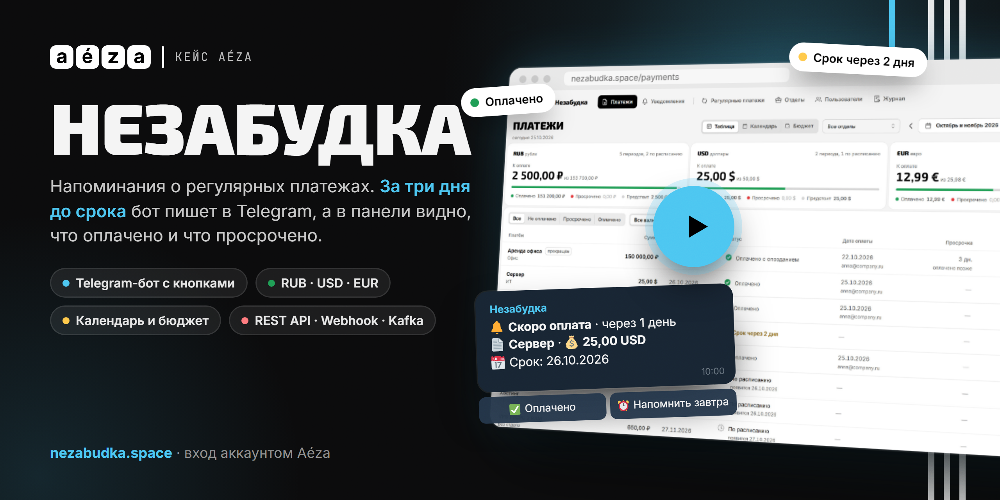
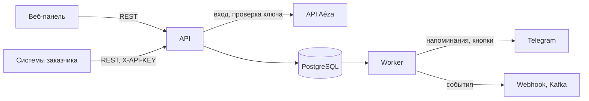

<p align="center">
  
</p>

<h1 align="center">Незабудка</h1>

<p align="center">
  Напоминания о регулярных платежах: аренда, подписки, серверы.<br>
  За три дня до срока бот пишет в Telegram, в панели видно, что оплачено и что просрочено.<br>
  Кейс компании Aéza.
</p>

<p align="center">
  <a href="https://nezabudka.space">Демо</a> ·
  <a href="https://nezabudka.space/api/v1/docs">API</a> ·
  <a href="docs/Case.md">Кейс</a> ·
  <a href="docs/ADR.md">Архитектурные решения</a>
</p>

<p align="center">
  <a href="docs/assets/nezabudka-demo.mp4"></a><br>
  <sub>Незабудка за 46 секунд: нажмите, чтобы посмотреть видео</sub>
</p>

## Что умеет

- **Регулярные платежи.** Любой период: каждые N дней, недель, месяцев или лет. Бессрочно или заданное число раз. Прекращённый платёж можно возобновить.
- **Периоды и оплата.** У каждого периода свой срок и своя отметка оплаты. Оплату можно отменить и исправить её дату. Просрочка начинается со следующего дня после срока.
- **Итоги по валютам.** RUB, USD и EUR считаются отдельно, без конвертации. Есть таблица, календарь, бюджет по месяцам и прогноз будущих платежей.
- **Telegram.** Напоминание за 3 дня и о просрочке, без дублей. Сообщения уходят в общий чат, в групповые чаты и темы супергрупп по отделам и в личный чат тем, кто захотел. Под сообщением кнопки "Оплачено" и "Напомнить завтра".
- **Вход аккаунтом Aéza.** Пароль и 2FA проверяет Aéza, у нас белый список и роли: администратор, пользователь, интеграция. Права проверяются и в API.
- **Отделы и журнал.** Отделы - необязательная группировка платежей и фильтр получателей. Журнал показывает, кто и что менял.
- **Встраивание.** REST API с ключом `X-API-KEY` аккаунта Aéza. События об изменениях отправляются на webhook с подписью HMAC и в Kafka.

## Как устроено



Изменение, напоминание и событие для интеграций пишутся в одной транзакции. Worker раз в минуту досоздаёт периоды и ставит напоминания в очередь. Отправка идёт каждые 2 секунды. Одно напоминание каждого вида на период и получателя гарантирует база.

| Часть | Технологии |
| --- | --- |
| Backend | Python 3.12, FastAPI, SQLAlchemy 2 (async), PostgreSQL 17, Alembic, aiogram, aiokafka |
| Frontend | React 19, TypeScript, Vite, Mantine, TanStack Router, Query и Form |
| Инфраструктура | Docker Compose, Caddy, Prometheus, Loki, Grafana, pgAdmin, GitHub Actions |

## Запуск на своей машине

Поднимается вся система, как на сервере: панель, API, worker, PostgreSQL, Kafka, Grafana и pgAdmin. Вход работает без аккаунта Aéza, тестовые данные загружаются одной командой.

### 1. Что нужно

- Docker с Compose v2: Docker Desktop на Windows и macOS или Docker Engine на Linux.
- 2-3 ГБ свободной памяти: запущенные сервисы занимают около 2 ГБ.
- Свободный порт 8090.

### 2. Скачать код

```bash
git clone https://github.com/VegasYT/aeza-nezabudka.git
cd aeza-nezabudka
```

### 3. Запустить

```bash
docker compose -f infra/compose.prod.yaml --env-file infra/local.env up -d --build --wait
```

Первая сборка с загрузкой образов занимает несколько минут. Команда завершится, когда все сервисы будут готовы. Настройки лежат в [`infra/local.env`](infra/local.env): секретов там нет, пароли только для локальной проверки.

### 4. Загрузить тестовые данные

```bash
docker compose -f infra/compose.prod.yaml --env-file infra/local.env run --rm seed
```

Появятся три платежа в разных валютах и два отдела. Аренда офиса просрочена на 5 дней, срок оплаты сервера через 2 дня. Повторный запуск ничего не добавляет.

### 5. Открыть панель

Откройте http://localhost:8090. Пароль у всех тестовых аккаунтов - `dev`.

| Email | Роль | Что показывает |
| --- | --- | --- |
| `admin@dev.local` | администратор | все возможности |
| `admin+2fa@dev.local` | администратор | вход с 2FA, код `000000` |
| `user@dev.local` | пользователь | ограничения роли: платежи только смотрит и отмечает оплату |

Остальные адреса:

| Адрес | Что это | Вход |
| --- | --- | --- |
| http://localhost:8090/api/v1/docs | Swagger | кнопка Authorize, `session` из `POST /auth/use-challenge` или ключ `dev:admin@dev.local:dev` |
| http://grafana.localhost:8090 | метрики, дашборд и логи | `admin` / `nezabudka` |
| http://pgadmin.localhost:8090 | база данных | `admin@nezabudka.space` / `nezabudka`, пароль базы `local` |
| http://kafka.localhost:8090 | события в Kafka | `admin` / `nezabudka` |

Адреса вида `*.localhost` открываются в Chrome, Edge и Firefox. Если браузер их не находит, добавьте в файл hosts строку `127.0.0.1 grafana.localhost pgadmin.localhost kafka.localhost`.

### 6. Подключить Telegram (необязательно)

Без бота всё работает, напоминания просто копятся в очереди.

1. Создайте бота у [@BotFather](https://t.me/BotFather) и скопируйте токен.
2. Впишите токен в `infra/local.env` в строку `TELEGRAM_BOT_TOKEN`.
3. Перезапустите командой из шага 3.
4. В панели откройте раздел "Уведомления". Там подключается личный чат с ботом, а в блоке "Групповые чаты" кнопка "Подключить группу" даёт ссылку, по которой бот добавляется в группу или тему супергруппы.

В течение минуты после подключения в чат придут напоминания о просроченной аренде и о сервере. Под ними будут кнопки "Оплачено" и "Напомнить завтра".

### Свой аккаунт Aéza

Добавьте email аккаунта через запятую в `ADMIN_EMAILS` в `infra/local.env` и перезапустите. Вход пойдёт через настоящий API Aéza с вашим паролем и 2FA.

### Остановить

```bash
# остановить, данные сохранятся
docker compose -f infra/compose.prod.yaml --env-file infra/local.env down
# остановить и стереть данные
docker compose -f infra/compose.prod.yaml --env-file infra/local.env down -v
```

Если порт 8090 занят, замените его в `infra/local.env` в строках `DOMAIN` и `HTTP_PORT`.

Выкладка на сервер с доменом и HTTPS описана в [infra/README.md](infra/README.md).

## Проверки

```bash
cd backend
uv sync
uv run pytest            # около минуты, нужен Docker
uv run ruff check . && uv run mypy . && uv run lint-imports
```

```bash
cd frontend
pnpm install
pnpm test
```

## Репозиторий

| Папка | Содержимое |
| --- | --- |
| [`backend/`](backend/AGENTS.md) | API, worker, Telegram-бот, миграции, тесты |
| [`frontend/`](frontend/AGENTS.md) | веб-панель |
| [`infra/`](infra/README.md) | Docker Compose, прокси, наблюдаемость, выкладка |
| [`docs/`](docs/) | кейс, архитектурные решения, план, диаграммы |
| [`openspec/`](openspec/specs/) | требования к системе по возможностям |

Контракт API - [`backend/api/openapi.yaml`](backend/api/openapi.yaml): он выгружается из кода, из него генерируется клиент панели.
